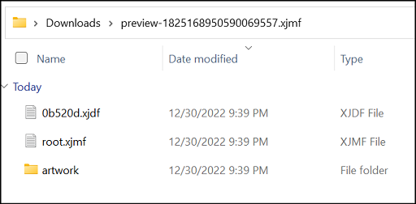

# CIP4 XJDF Java Library

[](https://central.sonatype.com/artifact/org.cip4.lib.xjdf/xJdfLib)
[](https://javadoc.io/doc/org.cip4.lib.xjdf/xJdfLib)
[](https://github.com/cip4/xJdfLib/actions/workflows/pull-request.yml)
[](https://adoptium.net/)
[](https://github.com/cip4/xJdfLib/blob/main/LICENSE.md)

xJdfLib is a Java library for [XJDF](https://www.cip4.org/) (JDF 2.0) and XJMF. XJDF no longer
models an entire job as one large ticket. Instead, each XJDF document describes a single transaction between two
applications, and a job is modeled as one or more transactions. xJdfLib is a lightweight, type-safe library for
creating, reading, validating and packaging those documents.

## Features

- Generate and parse XJDF 2.x and XJMF documents.
- Type-safe schema classes with fluent builders, generated from the official CIP4 XSD.
- Helpers for headers, audit entries, resource sets and partitioned resources.
- Exact numeric XJDF types such as `XYPair`, `Matrix`, `Rectangle`, `Shape`, `DateTime` and `Duration`.
- XJDF/XJMF ZIP package creation and extraction.
- XML Schema validation on read and write.

## Requirements

- Java 21 or newer.
- A Jakarta XML Binding implementation. xJdfLib declares `jaxb-impl` at runtime; if you compile against JAXB
  annotations or types, add `jakarta.xml.bind:jakarta.xml.bind-api` yourself.

## Installation

Gradle:

```groovy
dependencies {
    implementation 'org.cip4.lib.xjdf:xJdfLib:2.3.+'
}
```

Maven:

```xml
<dependency>
    <groupId>org.cip4.lib.xjdf</groupId>
    <artifactId>xJdfLib</artifactId>
    <version>2.3.17</version>
</dependency>
```

The current version is shown in the Maven Central badge above.

## Quick Start

### Initialize the library

Set the agent constants once at application start. They are used to create default headers and audit entries.

```java
XJdfConstants.AGENT_NAME = "PreviewService";
XJdfConstants.AGENT_VERSION = "1.2.34";
XJdfConstants.DEVICE_ID = "PREVIEW_SERVICE";
```

The examples below omit exception handling. `toXml()`, the parsers and some document helpers throw checked
exceptions such as `XJdfParseException`, `XJdfValidationException` and `XJdfDocumentException`.

> `org.cip4.lib.xjdf.type.URI` is the XJDF URI type. It is not `java.net.URI`.

### Create an XJMF message

```java
XJmfMessage xJmfMessage = new XJmfMessage();
xJmfMessage.addMessage(
    new CommandSubmitQueueEntry().withQueueSubmissionParams(
        new QueueSubmissionParams().withURL(new URI("https://example.org/my-job.xjdf"))
    )
);

byte[] bytes = xJmfMessage.toXml();
```

The `XJmfMessage` class generates the XJMF root element and the headers. `AgentName`, `AgentVersion` and `DeviceID`
are taken from the constants above. Only the actual message needs to be defined.

<details>
<summary>Generated XJMF</summary>

```xml
<?xml version="1.0" encoding="UTF-8" standalone="yes"?>
<XJMF Version="2.3" xmlns="http://www.CIP4.org/JDFSchema_2_0">
  <Header AgentName="PreviewService" AgentVersion="1.2.34" DeviceID="PREVIEW_SERVICE" Time="2022-12-29T14:33:54.516+01:00"/>
  <CommandSubmitQueueEntry>
    <Header AgentName="PreviewService" AgentVersion="1.2.34" DeviceID="PREVIEW_SERVICE" Time="2022-12-29T14:33:54.516+01:00"/>
    <QueueSubmissionParams URL="https://example.org/my-job.xjdf"/>
  </CommandSubmitQueueEntry>
</XJMF>
```
</details>

### Read an XJMF message

```java
byte[] xJmfBytes = ...;

XJmfMessage xJmfMessage = new XJmfMessage(xJmfBytes);
Message message = xJmfMessage.getMessages().get(0);

if (message instanceof CommandSubmitQueueEntry command) {
    URI url = command.getQueueSubmissionParams().getURL();
    String path = url.getUri().getPath();
}
```

`getMessages()` returns all messages contained in the XJMF root element. Cast the generic `Message` to the concrete
message type to access its attributes and elements.

### Create an XJDF document

```java
XJdfDocument xJdfDocument = new XJdfDocument("42", "Interpreting", "Rendering", "PreviewGeneration");

ResourceSet previewResourceSet = xJdfDocument.addResourceSet(Preview.class, ResourceSet.Usage.INPUT);

xJdfDocument.addSpecificResource(
    previewResourceSet,
    new Preview()
        .withPreviewFileType(Preview.PreviewFileType.PNG)
        .withFileSpec(new FileSpec().withURL(new URI("preview.png")))
);

byte[] bytes = xJdfDocument.toXml();
```

The required `JobID` and `Types` attributes are set by the constructor. The `AuditPool` is generated automatically
from the constants.

<details>
<summary>Generated XJDF</summary>

```xml
<?xml version="1.0" encoding="UTF-8" standalone="yes"?>
<XJDF JobID="42" Types="Interpreting Rendering PreviewGeneration" Version="2.3" xmlns="http://www.CIP4.org/JDFSchema_2_0">
  <AuditPool>
    <AuditCreated>
      <Header AgentName="PreviewService" AgentVersion="1.2.34" DeviceID="PREVIEW_SERVICE" Time="2023-07-12T09:11:09.063+02:00"/>
    </AuditCreated>
  </AuditPool>
  <ResourceSet Name="Preview" Usage="Input">
    <Resource>
      <Preview PreviewFileType="PNG">
        <FileSpec URL="preview.png"/>
      </Preview>
    </Resource>
  </ResourceSet>
</XJDF>
```
</details>

### Partitioned resources

A single resource set can hold multiple resources, each identified by a `Part`:

```java
XJdfDocument xJdfDocument = new XJdfDocument("42", "Interpreting", "Rendering", "PreviewGeneration");

ResourceSet previewResourceSet = xJdfDocument.addResourceSet(Preview.class, ResourceSet.Usage.INPUT);

xJdfDocument.addSpecificResource(
    previewResourceSet,
    new Preview()
        .withPreviewFileType(Preview.PreviewFileType.PNG)
        .withFileSpec(new FileSpec().withURL(new URI("preview.png"))),
    new Part().withPreviewType(Part.PreviewType.VIEWABLE)
);

xJdfDocument.addSpecificResource(
    previewResourceSet,
    new Preview()
        .withPreviewFileType(Preview.PreviewFileType.PNG)
        .withFileSpec(new FileSpec().withURL(new URI("thumb.png"))),
    new Part().withPreviewType(Part.PreviewType.THUMB_NAIL)
);

byte[] bytes = xJdfDocument.toXml();
```

<details>
<summary>Generated XJDF</summary>

```xml
<?xml version="1.0" encoding="UTF-8" standalone="yes"?>
<XJDF JobID="42" Types="Interpreting Rendering PreviewGeneration" Version="2.3" xmlns="http://www.CIP4.org/JDFSchema_2_0">
  <AuditPool>
    <AuditCreated>
      <Header AgentName="PreviewService" AgentVersion="1.2.34" DeviceID="PREVIEW_SERVICE" Time="2023-07-12T09:13:37.210+02:00"/>
    </AuditCreated>
  </AuditPool>
  <ResourceSet Name="Preview" Usage="Input">
    <Resource>
      <Part PreviewType="Viewable"/>
      <Preview PreviewFileType="PNG">
        <FileSpec URL="preview.png"/>
      </Preview>
    </Resource>
    <Resource>
      <Part PreviewType="ThumbNail"/>
      <Preview PreviewFileType="PNG">
        <FileSpec URL="thumb.png"/>
      </Preview>
    </Resource>
  </ResourceSet>
</XJDF>
```
</details>

### Create an XJDF ZIP package

An XJDF ZIP package bundles a single XJDF document together with the files it references. The entry names of the
files must match the relative URLs used by the document. The XJDF document is always the first entry of the archive:

```java
XJdfZipPackage xJdfZipPackage = new XJdfZipPackage.Builder()
    .withXJdfDocument(new URI("0b520d.xjdf"), xJdfDocument)
    .withFile(new URI("artwork/my-artwork.pdf"), artwork)
    .build();

byte[] zip = xJdfZipPackage.packageFiles();
```

Omitting the entry name in `withXJdfDocument(xJdfDocument)` derives it from the JobID of the document.

### Create a ZIP package

An XJMF ZIP package bundles the XJMF root message, one or more XJDF documents and referenced files:

```java
// load artwork
byte[] artwork = ...;
URI artworkUri = new URI("artwork/my-artwork.pdf");

// create XJDF document
String jobId = UUID.randomUUID().toString().substring(0, 6);
XJdfDocument xJdfDocument = new XJdfDocument(jobId, "PreviewGeneration");

ResourceSet runListResourceSet = xJdfDocument.addResourceSet(RunList.class, ResourceSet.Usage.INPUT);
xJdfDocument.addSpecificResource(
    runListResourceSet,
    new RunList().withFileSpec(new FileSpec().withURL(artworkUri))
);

ResourceSet previewGenerationParamsResourceSet =
    xJdfDocument.addResourceSet(PreviewGenerationParams.class, ResourceSet.Usage.INPUT);
xJdfDocument.addSpecificResource(
    previewGenerationParamsResourceSet,
    new PreviewGenerationParams().withResolution(new XYPair(72f, 72f))
);

URI xJdfDocumentUri = new URI(jobId + ".xjdf");

// create XJMF message that refers to the XJDF document
XJmfMessage xJmfMessage = new XJmfMessage();
xJmfMessage.addMessage(
    new CommandSubmitQueueEntry()
        .withQueueSubmissionParams(new QueueSubmissionParams().withURL(xJdfDocumentUri))
);

// create the zip package
byte[] xjmfZipPackage = new XJmfZipPackage.Builder()
    .withXJmfRoot(xJmfMessage)
    .withXJdfDocument(xJdfDocumentUri, xJdfDocument)
    .withFile(artworkUri, artwork)
    .build()
    .packageFiles();
```

Alternatively, compose the package from a ready-made `XJdfZipPackage`. Its entries keep their names, so
`QueueSubmissionParams/@URL` refers to `xJdfZipPackage.getXJdfUri()`:

```java
byte[] xjmfZipPackage = new XJmfZipPackage.Builder()
    .withXJmfRoot(xJmfMessage)
    .withXJdfZipPackage(xJdfZipPackage)
    .build()
    .packageFiles();
```

The resulting ZIP package contains `root.xjmf`, the XJDF document and the referenced artwork:



## Development

Build and test with the Gradle wrapper (JDK 21):

```bash
./gradlew build     # compile, generate schema classes, test, create jars
./gradlew test      # run the tests
./gradlew javadoc   # generate the API documentation in build/docs/javadoc
./gradlew test --tests "org.cip4.lib.xjdf.type.*"
```

JAXB classes are generated from `jdfschema_2_x.xsd` and `binding.xjb` into `src/generated`; never edit them by hand.

## Maintainers: release a version

Pushing a `X.Y.Z` tag builds, publishes to the Central Maven Repository and creates a GitHub release:

```bash
git tag -a 2.3.18 -m "Release 2.3.18"
git push origin 2.3.18
```

Publication to Maven Central can take up to two hours. To withdraw a broken release:

```bash
git tag -d 2.3.18
git push origin :refs/tags/2.3.18
```

## Links

- CIP4: https://www.cip4.org/
- XJDF schemas: https://schema.cip4.org/
- Issue tracking: https://cip4.atlassian.net/browse/XJDFLIB
- Maven Central: https://central.sonatype.com/artifact/org.cip4.lib.xjdf/xJdfLib
- API documentation: https://javadoc.io/doc/org.cip4.lib.xjdf/xJdfLib
- License: https://github.com/cip4/xJdfLib/blob/main/LICENSE.md
